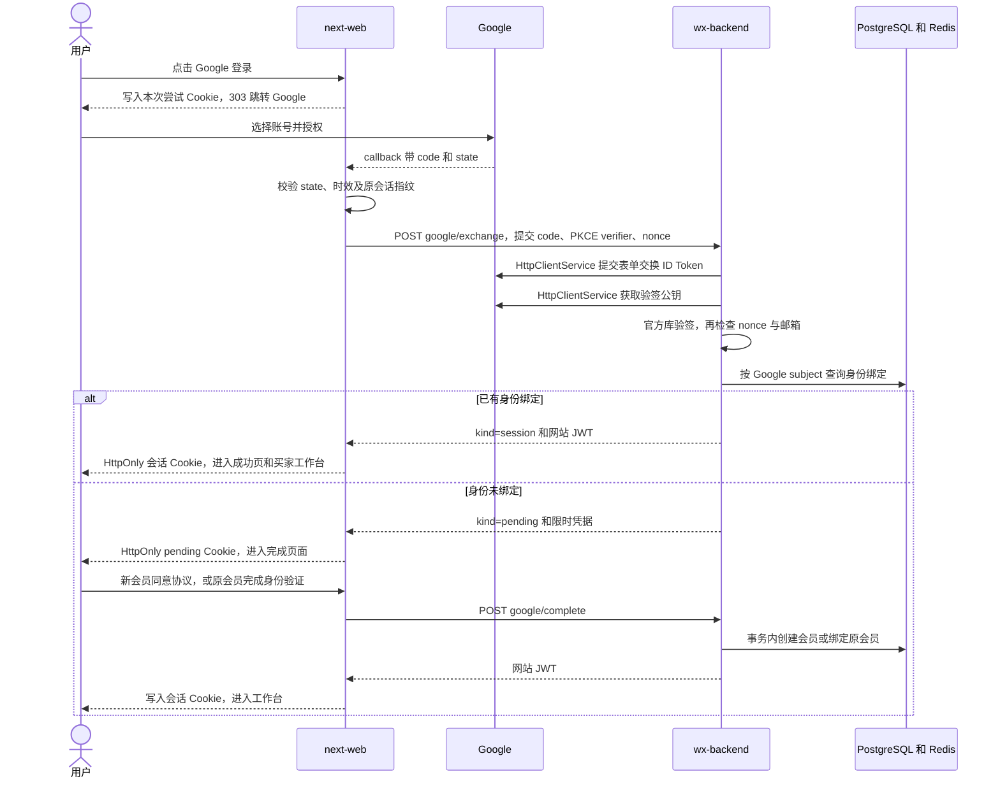

# 制造帮 Google 登录接入与排错指南

更新时间：2026 年 10 月 19 日。适用代码：`next-web` 与 `wx-backend` 的当前 `dev` 工作区。

本文面向需要维护、部署和排查制造帮 Google 登录的开发人员，按“准备配置 → 发起授权 → 后端验签 → 匹配会员 → 注册或绑定 → 建立网站会话 → 账号安全管理”的实际顺序展开。所有关键代码以当前仓库为准，节选用于解释步骤，不是可单独复制运行的完整文件。

**最终实现：Google 的网络请求复用项目已有的 `HttpClientService`，Google 官方库只负责身份 Token 验签；网页登录继续使用统一会员表和独立的网站会话。**

## 目录

1. [当前状态与验收范围](#1-当前状态与验收范围)
2. [参与系统与整体流程](#2-参与系统与整体流程)
3. [Google 控制台准备](#3-google-控制台准备)
4. [本地与开发环境配置](#4-本地与开发环境配置)
5. [从点击按钮到 Google 回调](#5-从点击按钮到-google-回调)
6. [后端交换授权码与验证身份](#6-后端交换授权码与验证身份)
7. [按身份匹配会员](#7-按身份匹配会员)
8. [新会员注册](#8-新会员注册)
9. [同邮箱老会员验证与绑定](#9-同邮箱老会员验证与绑定)
10. [签发网站登录会话](#10-签发网站登录会话)
11. [已登录账号绑定 Google](#11-已登录账号绑定-google)
12. [解绑 Google 与设置首个密码](#12-解绑-google-与设置首个密码)
13. [数据库结构与迁移](#13-数据库结构与迁移)
14. [接口和临时凭据清单](#14-接口和临时凭据清单)
15. [安全边界与失败恢复](#15-安全边界与失败恢复)
16. [今天遇到的问题及处理结果](#16-今天遇到的问题及处理结果)
17. [测试与逐项验收](#17-测试与逐项验收)
18. [正式环境部署步骤](#18-正式环境部署步骤)
19. [代码导航与后续待补信息](#19-代码导航与后续待补信息)

## 1 当前状态与验收范围

| 项目 | 当前状态 | 依据或下一步 |
| --- | --- | --- |
| Google 应用发布状态 | 测试中，先供测试账号使用 | 用户已确认 |
| 正式网站域名和正式 API 地址 | 待定 | 确定后同步控制台、前端、后端及代理配置 |
| 同邮箱老会员 Google 关联并登录网站 | 用户已验证成功 | 用户确认“已完成原账号验证并登录网站” |
| 当前 dev 数据库结构 | 已核对存在且完整 | `registration_method`、绑定表、唯一约束、外键和迁移记录均存在；本次检查没有重复迁移 |
| 新会员注册、解绑、首个密码等分支 | 代码已实现，离线测试覆盖 | 仍需按第 17 节分别做真实环境验收 |
| 后端测试 | 最近一次 737 项通过，9 项跳过 | 对应 HTTP 封装复用后的完整测试；跳过项不能算已通过 |
| 网站测试 | 最近一次 134 项通过 | 另有真实 Semi UI 的离线浏览器交互检查 |
| 构建 | 两端最近一次构建通过 | 网站使用隔离构建目录 `.next-verify` |
| 提交和部署 | 这些修改仍在 `dev` 工作区，未在本次工作中提交、推送或部署 | 提交前核对全部已有改动，不把本文当作部署完成证明 |

“Google 授权页能打开”“回调成功”“原会员关联成功”“网站会话建立成功”是四个不同的检查点。用户已确认的是原会员关联后能登录网站，不能据此推定所有注册和账号安全分支都已完成真实验收。

## 2 参与系统与整体流程

### 2.1 各系统负责什么

| 系统 | 职责 | 不承担的职责 |
| --- | --- | --- |
| 浏览器 | 显示登录、注册、原账号验证及账号安全页面，跳转 Google | 不保存客户端密钥，不读取后端 JWT 或待完成凭据 |
| `next-web` 服务端 | 生成 state、PKCE、nonce；保存 HttpOnly Cookie；处理 Google 回调；代理后端请求；写网站会话 Cookie | 不自行相信浏览器提交的 Google 邮箱，不直接写会员表 |
| `wx-backend` | 交换授权码、下载公钥、验签、会员匹配、事务绑定、验证码、限流及 JWT | 不把 Google Token 或客户端密钥交给浏览器 |
| Google | 用户选择账号、授权，返回一次性授权码；Token 接口返回经过签名的身份信息 | 不负责制造帮会员权限、原会员合并或网站 JWT |
| PostgreSQL | 保存会员、Google 身份绑定、注册方式、协议同意记录及会话版本 | 不保存 Google access/refresh/ID Token |
| Redis | 保存限时待完成状态、绑定凭据、验证码摘要、并发租约及限流计数 | 不作为永久会员身份库 |
| 邮件服务 | 按 `zh` / `en` 发送操作验证码 | 不用新申请者任意填写的邮箱替代原账号已验证邮箱 |

BFF 指网站服务端代理层：浏览器只访问同源 `/api/auth/...`，由 Next.js 再调用后端 `/api/v1/web/site-auth/...`。

### 2.2 一次普通 Google 登录



### 2.3 先认识这些值

| 名称 | 含义 | 放在哪里 |
| --- | --- | --- |
| `client_id` | Google 给这个网站应用的公开客户端标识 | 前后端配置都需要；不是密钥 |
| `client_secret` | 后端向 Google 交换授权码时使用的应用密钥 | 仅后端私有环境配置 |
| `code` | Google 回调的一次性授权码 | 短暂经过回调和后端，不持久化、不记录日志 |
| `state` | 将回调与发起授权的浏览器尝试对应，防止伪造回调 | Google 请求参数和本次 HttpOnly Cookie |
| PKCE `verifier` | 本次授权使用的随机秘密字符串 | HttpOnly Cookie，随后由后端交给 Google |
| PKCE `challenge` | `verifier` 的 SHA-256 Base64URL 摘要 | Google 授权 URL，方法为 `S256` |
| `nonce` | 将 Google 签名身份 Token 与本次授权对应 | 授权参数、尝试 Cookie、后端校验 |
| Google `sub` | Google 账号的稳定身份标识 | 保存为绑定表 `subject`，用它识别第三方身份 |
| `pendingToken` | 制造帮自己生成的待完成注册或绑定凭据 | Next HttpOnly Cookie 与 Redis；不是 Google Token |
| `pendingId` | `pendingToken` 的 SHA-256 摘要，用于识别页面对应哪次尝试 | 可给浏览器；不能当作后端授权凭据 |
| `bindingGrant` | 原会员重新验证后领取的短时绑定凭据 | HttpOnly Cookie、授权尝试 Cookie及 Redis |
| 网站 JWT | 制造帮后端签发的网站登录凭据 | `public_web_token` HttpOnly Cookie |
| `tokenVersion` | 会员会话版本；递增后旧版本 JWT 失效 | 会员表、JWT、后端校验 |

## 3 Google 控制台准备

### 3.1 项目与客户端

1. 登录 Google Cloud，选择制造帮使用的项目。
2. 进入 Google Auth Platform，完善品牌信息与受众设置。
3. 在“客户端”创建或编辑 **Web 应用** 类型客户端。
4. 客户端名称使用可辨识名称，例如 `ManuLink Web`。
5. 当前使用的公开客户端 ID：

```text
40147658699-qvidngu34avkg18eqqu85s4nom958fvo.apps.googleusercontent.com
```

6. 客户端密钥保存在后端私有环境文件或生产密钥管理系统中。本文不记录真实密钥，也不提供下载密钥 JSON 的公开链接。

### 3.2 来源与回调地址

当前本地网站来源为 `http://localhost:3000`。

- “已获授权的 JavaScript 来源”：可登记本地网站的 origin `http://localhost:3000`。来源不带页面路径。
- “已获授权的重定向 URI”：必须登记 `http://localhost:3000/api/auth/google/callback`。
- 当前实现使用服务器授权码回调；**回调地址应指向 Next.js，不是后端的 4000 端口，也不是登录页**。
- 控制台、Next.js 配置、后端配置三处回调地址必须一致。协议、域名、端口、路径和结尾斜杠都要核对。
- `localhost` 和 `127.0.0.1` 是不同来源。不要一边从 `127.0.0.1` 发起，另一边固定回到 `localhost`，否则原先 Cookie 可能无法随回调带回。

正式域名待定。确定后再增加正式 HTTPS 回调，不把示例域名当作已配置的正式地址。

Google 对回调精确匹配、state 和服务端授权码流程的规则见 [Google OpenID Connect 官方说明](https://developers.google.com/identity/openid-connect/openid-connect)。

### 3.3 测试受众与品牌链接

当前按测试应用使用。控制台有测试用户配置项时，维护参与验收的 Google 邮箱，并按当前受众和权限范围核对允许登录的账号。

品牌信息包括应用名称、Logo、支持邮箱、主页、隐私政策和服务条款链接。网站已有 `/privacy` 与 `/terms` 路由；正式环境要用最终公开 HTTPS 域名组合，不能填写本机文件路径。当前正式域名未确定，这些正式链接也仍待确定。

本实现只申请 `openid email profile`，未申请读取 Gmail、Google Drive 等业务数据的权限，也未实现离线访问授权。

## 4 本地与开发环境配置

### 4.1 网站配置

当前环境配置入口：

- `next-web/config/environments/local.env`
- `next-web/config/environments/development.env`
- 对应 `.env.example` 为可以提交的模板；实际 `.env` 文件已被忽略。
- `scripts/with-environment.ts` 读取选定环境，再启动 Next.js。

本地示例，不含秘密：

```dotenv
NEXT_PUBLIC_SITE_URL=http://localhost:3000
MEMBER_API_URL=http://localhost:4000/api/v1
GOOGLE_CLIENT_ID=40147658699-qvidngu34avkg18eqqu85s4nom958fvo.apps.googleusercontent.com
GOOGLE_REDIRECT_URI=http://localhost:3000/api/auth/google/callback
```

1. `MEMBER_API_URL` 要保留 `/api/v1`。
2. 前端 `GOOGLE_CLIENT_ID` 必须与后端一致。
3. 未配置客户端 ID 时，登录和注册页不展示可用的 Google 登录入口。
4. 客户端 ID 已设置但回调省略时，前端可从站点来源推导固定回调路径；配置解析仍要求最终回调恰好等于该站点来源加固定路径。
5. **Next.js 不需要也不应配置 `GOOGLE_CLIENT_SECRET`。**

### 4.2 后端配置

后端开发启动脚本通过 Node 的 `--env-file=.env.development` 加载环境文件。

```dotenv
GOOGLE_CLIENT_ID=40147658699-qvidngu34avkg18eqqu85s4nom958fvo.apps.googleusercontent.com
GOOGLE_CLIENT_SECRET=<仅在私有环境中填入真实值>
GOOGLE_REDIRECT_URI=http://localhost:3000/api/auth/google/callback
PUBLIC_WEB_URL=http://localhost:3000
PUBLIC_WEB_JWT_SECRET=<生产至少32字符的独立随机密钥>
PUBLIC_WEB_TRUSTED_PROXY_IPS=127.0.0.1,::1
HTTPS_PROXY=http://127.0.0.1:17891
NO_PROXY=localhost,127.0.0.1,::1
```

- `GOOGLE_REDIRECT_URI` 可显式配置；后端未配置时可按 `PUBLIC_WEB_URL` 加回调路径推导。必须与本次请求传入值相同。
- `PUBLIC_WEB_JWT_SECRET` 与 Google 客户端密钥是两件事。前者签制造帮网站 JWT，后者用于向 Google 证明应用身份。
- 开发允许 localhost HTTP；生产回调必须 HTTPS。
- 本地 HTTP 代理端口 `17891` 是本机当时实际系统代理端口，不是项目固定标准。换机器后重新核对。
- `HTTPS_PROXY` 是后端进程级配置，会被支持该环境变量的出站客户端使用，不仅限于 Google；`NO_PROXY` 用于避免本地流量走代理。
- 浏览器采用系统代理，不代表 Node 自动采用系统代理。更改环境文件后需要重新加载后端进程，热更新源码不能保证环境变量重新读取。

### 4.3 配置核对顺序

1. 核对实际使用的 `local` 或 `development` 配置，避免改错环境文件。
2. 比较前后端公开客户端 ID，不能只看控制台名称相同。
3. 核对三处回调地址相同。
4. 确认后端能访问 Token 接口和公钥接口。
5. 确认 PostgreSQL、Redis、网站签名密钥可用。
6. 需要原会员邮箱验证码、首个密码设置等流程时，确认邮件服务已配置。
7. 不把包含客户端密钥的环境文件内容粘贴到日志或文档。

### 4.4 依赖安装与运行版本

| 仓库 | packageManager | Node engines | 本次依赖变化 |
| --- | --- | --- | --- |
| next-web | pnpm 10.33.0 | >=22.12.0 | 没有新增运行依赖，继续使用 Semi UI |
| wx-backend | pnpm 9.15.9 | >=20.0.0 且 <23.0.0 | 增加 google-auth-library，增加测试用 PGlite |

两仓库共同兼容的 Node 主版本是 22，且需满足网站的最低版本要求。不要把不同仓库的 pnpm 版本和锁文件格式随意混用。

后端依赖约束：`google-auth-library ^11.3.1`；测试依赖 `@electric-sql/pglite ^0.5.10`。共享请求复用已有 `axios` 与 `@nestjs/axios`，无需为本次重构再安装另一套 HTTP 库。

在各自仓库使用对应 packageManager 执行：

```bash
pnpm install --frozen-lockfile
```

本机已经安装过时显示 `Already up to date` 是正常结果；它只说明依赖与锁文件匹配，不代表超时、请求格式或会员逻辑已经修复。

## 5 从点击按钮到 Google 回调

### 步骤 1 登录或注册页点击 Google 按钮

入口是共用的 `GoogleButton`，使用 Semi UI 的按钮薄包装，读取当前语言和安全回跳地址。

```ts
      onClick={() => {
        const url = new URL("/api/auth/google/start", window.location.origin);
        url.search = new URLSearchParams({
          returnTo: safeReturnTo(returnTo),
          locale,
        }).toString();
        window.location.assign(url.toString());
      }}
```

期望：浏览器执行整页导航到 `/api/auth/google/start?returnTo=...&locale=zh|en`，不是在前端直接提交客户端密钥给 Google。

### 步骤 2 生成本次授权尝试

Next.js 服务端生成三个不同的 32 字节随机值：`state`、`verifier`、`nonce`。编码后每个值为 43 字符 Base64URL 字符串。

同时记录安全的 `returnTo`、创建时间以及当前网站 JWT 的 SHA-256 指纹；匿名访问的指纹来自固定匿名标记，不会把已有 JWT 放进授权 URL。

```ts
  const attempt: Attempt = {
    state: randomBytes(32).toString("base64url"),
    verifier: randomBytes(32).toString("base64url"),
    nonce: randomBytes(32).toString("base64url"),
    returnTo: safeReturnTo(request.nextUrl.searchParams.get("returnTo")),
    createdAt: Date.now(),
    fingerprint: sessionFingerprint(token),
  };
```

每次尝试使用独立 Cookie 名 `google_attempt_<state>`，避免另一标签页的授权回调消耗错 Cookie。Cookie 时效为 600 秒，路径仅为 `/api/auth/google/callback`，设置 HttpOnly、SameSite=Lax，HTTPS 网站设置 Secure。

### 步骤 3 构造 Google 授权 URL

```ts
  const url = new URL("https://accounts.google.com/o/oauth2/v2/auth");
  url.search = new URLSearchParams({
    client_id: google.clientId,
    redirect_uri: google.redirectUri,
    response_type: "code",
    scope: "openid email profile",
    state: attempt.state,
    nonce: attempt.nonce,
    code_challenge: createHash("sha256")
      .update(attempt.verifier)
      .digest("base64url"),
    code_challenge_method: "S256",
    prompt: "select_account",
    hl: request.nextUrl.searchParams.get("locale") === "zh" ? "zh-CN" : "en",
  }).toString();
```

- 固定授权入口为 `https://accounts.google.com/o/oauth2/v2/auth`。
- `response_type=code` 表示只让 Google 回调授权码。
- `code_challenge` 是 `verifier` 摘要，不能直接把 verifier 作为 challenge。
- `prompt=select_account` 让用户选择 Google 账号。
- 当前语言为中文时传 `hl=zh-CN`，其他支持语言传 `en`。
- 后端不请求 refresh token，也不使用浏览器的 Google access token 作为网站登录态。

写入尝试 Cookie 后，Next.js 返回 303 跳转；此前残留的 pending 和 binding Cookie 被清理。

### 步骤 4 Google 完成账号选择与授权

Google 成功时回调网站：

```text
GET /api/auth/google/callback?code=<一次性授权码>&state=<本次state>
```

用户取消时可能带 `error=access_denied`。不要复制真实带 code 的回调 URL 用于分享、写日志或反复刷新；授权码是一次性的。

### 步骤 5 Next.js 校验回调

顺序如下：

1. `state` 必须满足格式，再按它找到对应尝试 Cookie。
2. Cookie 中的 state 与回调 state 用定时安全比较函数比较。
3. 检查 nonce 和 verifier 格式。
4. 检查创建时间：不能来自未来，也不能达到或超过 10 分钟。
5. 比较发起授权时的网站会话指纹与当前 Cookie 指纹。
6. 当前会话已在其他页面切换或退出时，拒绝继续。
7. 用户取消时转到取消提示，不调用授权码交换。
8. code 缺失、超长或带其他 OAuth 错误时拒绝。

对应代码入口：[src/lib/server/google-authorization.ts](/Users/aldrich/Documents/next-web/src/lib/server/google-authorization.ts:114)。

这些校验完成后，Next.js 才向后端提交：

```json
{
  "code": "<Google一次性授权码>",
  "codeVerifier": "<Cookie中的verifier>",
  "nonce": "<Cookie中的nonce>",
  "redirectUri": "http://localhost:3000/api/auth/google/callback"
}
```

普通登录不需要网站 Bearer；已登录主动绑定流程还会携带 bindingGrant、当前网站 Bearer 和预期会员 ID。BFF 对授权码交换设置 20 秒超时，覆盖后端两次各最多 8 秒的 Google 请求；请求不自动重试授权码交换。

处理后清理本次尝试 Cookie，再跳转不含授权码、JWT 或临时凭据的页面。

## 6 后端交换授权码与验证身份

### 步骤 6 校验 DTO 和应用配置

后端入口是 `POST /api/v1/web/site-auth/google/exchange`。

- 控制器使用白名单、拒绝非白名单字段和转换校验。
- 授权码长度 1–4096，PKCE verifier 格式 43–128 字符；nonce 为 43 字符 Base64URL。
- 回调不是由浏览器任意指定：后端要求它与后端配置完全一致。
- 客户端 ID、密钥和回调不完整时返回 `google_unavailable`。
- 先检查网站 JWT 签名配置，再限流、访问 Google；避免配置缺失时先修改会员或消耗后续凭据。

代码：[src/domains/web/site-auth/site-google.controller.ts](/Users/aldrich/Documents/wx-backend/src/domains/web/site-auth/site-google.controller.ts:37)、[src/domains/web/site-auth/site-google.dto.ts](/Users/aldrich/Documents/wx-backend/src/domains/web/site-auth/site-google.dto.ts:1)、[src/domains/web/site-auth/google-identity.service.ts](/Users/aldrich/Documents/wx-backend/src/domains/web/site-auth/google-identity.service.ts:26)。

### 步骤 7 通过统一 HTTP 客户端提交表单

```ts
      const form = new URLSearchParams({
        client_id: clientId,
        client_secret: clientSecret,
        code: input.code,
        code_verifier: input.codeVerifier,
        redirect_uri: redirectUri,
        grant_type: 'authorization_code',
      });
      const tokens = await this.http.request<{ id_token?: string }>(
        {
          method: 'POST',
          url: 'https://oauth2.googleapis.com/token',
          headers: {
            'Content-Type': 'application/x-www-form-urlencoded;charset=UTF-8',
          },
          data: form.toString(),
          timeout: REQUEST_TIMEOUT_MS,
          maxRedirects: 0,
        },
        { sensitive: true },
      );
```

这里显式使用 `application/x-www-form-urlencoded;charset=UTF-8`，不是项目 HTTP 客户端默认的 JSON。

六个参数分别是客户端 ID、客户端密钥、一次性授权码、PKCE verifier、回调地址及授权类型。只有后端把它们发送给固定 Google Token 接口。`maxRedirects: 0` 避免认证请求跟随重定向；请求超时固定为 8000 毫秒。

`request(config, { sensitive: true })` 是这次对已有 `HttpClientService` 增加的可选参数；其他调用仍沿用原返回行为，只返回 `response.data`。

### 步骤 8 下载公钥并调用官方验签

```ts
      stage = 'signing_keys';
      const certificates = await this.http.request<Record<string, string>>(
        {
          method: 'GET',
          url: 'https://www.googleapis.com/oauth2/v1/certs',
          timeout: REQUEST_TIMEOUT_MS,
          maxRedirects: 0,
        },
        { sensitive: true },
      );
      // Keep signature/time/audience/issuer verification in Google's official SDK.
      stage = 'id_token_verification';
      const ticket = await client.verifySignedJwtWithCertsAsync(
        tokens.id_token,
        certificates,
        clientId,
        ['accounts.google.com', 'https://accounts.google.com'],
      );
```

当前每次交换后下载公钥，没有额外的共享公钥缓存。这里使用的是 PEM 证书接口，与当前 SDK 的证书验签方式配套。更换为 JWK 接口时不能只改 URL 而不核对对应格式。

Google 官方 SDK 的 `verifySignedJwtWithCertsAsync` 负责签名、受众、签发者和时间校验。它在本项目中不再自行发网络请求。

### 步骤 9 检查项目所需身份字段

验签后还会检查：

- `aud` 等于配置的客户端 ID。
- `iss` 为允许的 Google 签发者。
- `exp` 是有效且尚未过期的时间。
- `nonce` 与本次尝试一致。
- `sub` 非空且不超过 255 字符。
- 邮箱格式有效、长度不超过 128。
- `email_verified === true`。

仅返回内部身份资料：`subject`、规范化小写邮箱、昵称、`emailAuthoritative`。不把 ID Token、access token、refresh token 写入会员库或发给页面。

Google 邮箱权威性判断：Gmail，或带已签名 Workspace `hd` 声明的邮箱，作为 Google 权威邮箱；其他第三方域名即使 `email_verified=true`，新注册也额外要求邮箱验证码。这与 [Google 关于邮箱权威性及 ID Token 验证的说明](https://developers.google.com/identity/gsi/web/guides/verify-google-id-token) 一致。它不改变“同邮箱原会员必须证明原账号所有权”的规则。

### 步骤 10 归一化失败信息

`GoogleIdentityService` 在日志中记录失败阶段：

| stage | 含义 |
| --- | --- |
| `token_exchange` | 交换授权码 |
| `signing_keys` | 下载验签公钥 |
| `id_token_verification` | 官方库验签 |
| `claims_validation` | 项目字段及 nonce 校验 |

敏感 HTTP 请求只保留白名单 OAuth / 网络错误类别与状态码，不记录原始响应体、异常文本、URL 参数、密钥、授权码或 Token。

- 网络取消、超时、临时不可用、Google 429/5xx，以及无效应用凭据等配置问题映射为 503 `google_unavailable`。
- 授权码或身份校验失败映射为 401 `google_invalid`。
- `invalid_grant`、`nonce_mismatch` 等具体分类供后端排错，不直接把原始 Google 错误详情传给网页。

当前 Next.js OAuth 回调会将交换失败统一转到登录页的 `reason=google-invalid`，没有完整保留后端 401/503 的页面提示差异。因此排错应查看后端 stage/reason，不能仅凭网页的通用提示断定失败原因。

## 7 按身份匹配会员

### 步骤 11 优先查固定 Google 身份

查询条件是：

```ts
{ provider: 'google', subject: profile.subject }
```

邮箱用于发现可能需要关联的旧账号，但不是永久第三方身份主键。Google 邮箱或展示昵称变化时，已有身份仍按 subject 找到同一会员，登录不会自动覆盖会员邮箱或昵称。

### 步骤 12 已绑定会员直接登录

1. 先查 Google 身份绑定，得到 memberId。
2. 事务内锁住该会员行，加载会员状态及密码信息。
3. 会员不存在、已删除或禁用时拒绝，不偷偷创建替代会员。
4. **在锁内再次确认绑定仍存在**。
5. 更新绑定的 `last_used_at`。
6. 签发网站 JWT，返回 `{ kind: 'session', ...session }`。

锁内复查解决“查到 Google 身份后，另一个请求已经解绑并更新会话版本”的并发问题，防止已移除的登录方式获得新版本有效会话。

### 步骤 13 未绑定则准备待完成状态

1. 按规范化 Google 邮箱查原会员。
2. 有原会员：保存 profile、memberId、tokenVersion，待验证后关联。
3. 没有原会员：只保存 profile，等待注册确认。
4. 生成随机 `pendingToken`，Redis 只用其 SHA-256 摘要作为 key 的一部分。
5. 返回 `{ kind: 'pending', pendingToken, expiresIn: 600 }` 给 Next 服务端。
6. Next 把 token 保存在 `google_pending` HttpOnly Cookie，再跳到 `/google/complete`。

完整分支入口：[src/domains/web/site-auth/site-google.service.ts](/Users/aldrich/Documents/wx-backend/src/domains/web/site-auth/site-google.service.ts:129)。

### 步骤 14 完成页只拿必要状态

页面通过 `POST /api/auth/google/pending` 获取：

```json
{
  "mode": "link",
  "email": "buyer@example.com",
  "nickname": "Buyer",
  "requiresEmailVerification": false,
  "passwordAvailable": true,
  "canSendCode": true,
  "pendingId": "<不具备授权能力的摘要>"
}
```

上例仅演示字段。具体值由后端会员状态决定。页面和 JavaScript 拿不到 pendingToken。

`pendingId` 是 Next 加入的字段；发送验证码或完成表单时必须带回同一个 pendingId。若另一标签页用新的授权覆盖了 pending Cookie，旧页面提交会被拒绝，避免“页面显示 A，实际提交 B”的错误。

## 8 新会员注册

### 步骤 15 显示注册确认表单

`mode=register` 时：

1. 显示 Google 邮箱和可确认的昵称，昵称最多 32 字符。
2. 加载运营端已发布的当前语言协议内容与版本。
3. 用户明确勾选服务条款和隐私政策；不能直接把 Google 同意授权等同于接受制造帮协议。
4. 非 Google 权威邮箱还要发送并校验邮箱验证码。
5. 页面当前协议同意标识由“版本 + 语言”组成，切换语言或协议版本后要重新确认。

前端提交给 BFF 的示例：

```json
{
  "pendingId": "<页面收到的摘要>",
  "locale": "zh",
  "nickname": "Buyer",
  "acceptedTerms": true,
  "policyVersion": "<当前已发布版本>",
  "code": "<仅需要邮箱验证时填写六位验证码>"
}
```

BFF 去掉 pendingId，加入 HttpOnly Cookie 中的 pendingToken，再发给后端。后端只允许规定字段，不接收浏览器伪造的 subject、emailVerified 等身份结论。

### 步骤 16 在事务中创建会员和绑定

1. Redis 为待完成状态领取 60 秒处理租约，避免并发完成。
2. 确认已同意协议，需要时消费本次操作的正确邮箱验证码。
3. 事务内读取已发布协议并加共享锁，比较前端 policyVersion。
4. 再次检查邮箱是否已被其他注册占用。
5. 创建统一 `members` 会员与 Google 绑定，二者在同一数据库事务中保存。

```ts
          const created = await repository.save(
            repository.create({
              email: profile.email,
              nickname: input.nickname?.trim() || profile.nickname.slice(0, 32),
              emailVerifiedAt: new Date(),
              platform: 'web',
              openid: `web_${randomBytes(16).toString('hex')}`,
              source: 'web',
              registrationMethod: 'google',
              memberType: 'personal',
              status: 'active',
              mustChangePassword: false,
              tokenVersion: 0,
              privacyVersion: policy.version,
              privacyAgreedAt: new Date(),
            }),
          );
          await this.insertIdentity(manager, created, profile);
```

关键含义：

- `source='web'` 表示注册入口，`registrationMethod='google'` 表示最初注册方式。
- `platform='web'` 与占位 `openid=web_<随机值>` 沿用现有网站会员模型，Google subject 单独存在身份表。
- Google 注册不自动生成密码。登录会话里 `hasPassword=false`，以后可在账号安全设置首个密码。
- 当前不从 Google 头像 URL 下载图片或覆盖会员头像。
- 保存协议版本与同意时间，不能只让前端勾选而后端不存。
- 原有小程序和网站共用会员表，不额外创建 Google 专属会员表；但没有可靠身份关联信息时，不凭“可能是同一个人”自动合并两条会员记录。

成功后消费待完成状态并签发网站会话。若待完成后邮箱才被别的注册占用，拒绝并重新走授权入口，以最新数据库状态判断应该注册还是关联。

## 9 同邮箱老会员验证与绑定

### 步骤 17 验证原账号

`mode=link` 表明 Google 身份未绑定，但数据库里已经有同邮箱会员。页面提示“此邮箱已有账号，请先验证原账号，再关联 Google”。

两种原账号证明方式：

- 原会员已有密码：验证原会员密码。
- 原会员存在已验证邮箱：发送验证码到**原会员已验证的邮箱**，验证后关联。

原会员邮箱未验证时不能仅依靠向 Google 声称的同名邮箱发验证码完成关联。没有密码且没有已验证邮箱时，当前完成页不能继续，要先用原登录渠道证明原账号所有权；没有实现自动合并、人工申诉或原渠道快捷绑定页。

### 步骤 18 事务内绑定并更新版本

1. 按 memberId 施加共享的原账号验证限流；换 pendingToken 不能重置原账号密码尝试预算。
2. 锁住原会员，重新核对状态及待完成时记录的 tokenVersion。
3. 验证密码或本次 pending 操作的验证码。
4. 检查 Google subject 未被其他会员占用、该会员未绑定另一个 Google subject。
5. 插入身份记录。
6. `tokenVersion += 1`，使该会员旧网站会话失效。
7. 提交后签发新版本网站 JWT。

验证和绑定的关键节选：

```ts
          const existing = await this.locked(manager, {
            memberId: claim.value.memberId!,
            tokenVersion: claim.value.tokenVersion!,
          });
          if (input.password && existing.passwordHash) {
            if (!(await verifyPassword(existing.passwordHash, input.password)))
              siteFailure('invalid_credentials', HttpStatus.UNAUTHORIZED);
          } else {
            if (!existing.email || !existing.emailVerifiedAt)
              siteFailure('email_verification_required');
            if (!input.code) siteFailure('code_invalid');
            await this.codes.verify(key, existing.email, input.code);
          }
          await this.insertIdentity(manager, existing, profile);
          existing.tokenVersion += 1;
          await manager.getRepository(Member).save(existing);
```

不会覆盖原会员 ID、注册来源、注册方式、邮箱、昵称、企业类型和其他业务归属。网站再次登录不等于重新注册，也不会给历史会员回填一个猜测的 registrationMethod。

## 10 签发网站登录会话

### 步骤 19 后端签发自己的 JWT

```ts
    const accessToken = await this.jwt.signAsync(
      {
        sub: member.id,
        type: SITE_TOKEN_TYPE,
        tokenVersion: member.tokenVersion,
      },
      {
        secret: this.secret(),
        audience: SITE_AUDIENCE,
        issuer: SITE_ISSUER,
        expiresIn: SITE_SESSION_SECONDS,
      },
    );
```

JWT 中的 `sub` 此时是**制造帮 memberId**，不是 Google subject。两种 sub 属于两个不同的签发体系，不能混用。

网站会话参数：

| 项目 | 值 |
| --- | --- |
| 类型 | `public-web-member` |
| audience | `manulink-public-web` |
| issuer | `manulink` |
| 有效期 | 28800 秒，即 8 小时 |
| 必须校验 | 签名、类型、audience、issuer、版本、会员存在及 active 状态 |
| 不提供 | 自动换发网站 JWT 的 refresh token 流程 |

### 步骤 20 Next 写入 HttpOnly 网站 Cookie

`siteAuthResponse(..., 'login')` 读取后端 accessToken，写入 `public_web_token` Cookie，再从响应 JSON 中移除 JWT。

- Path=`/`，HttpOnly，SameSite=Lax。
- 有效期最多 8 小时。
- **普通网站会话 Cookie 的 Secure 取决于 `NODE_ENV === 'production'`；Google 临时 Cookie 的 Secure 则按站点 URL 是否 HTTPS 设置。**
- 使用本地 HTTP 调试时应运行开发模式；不要把生产 `next start` 的 Secure 会话 Cookie 行为与本地开发混为一谈。

已有绑定直接登录、显式绑定后替换会话，都通过 `/google/success` 的无 Token 过渡页通知其他页面会话已变更，再导航到安全 returnTo。待完成表单成功后也发送会话变更事件。

有 `mustChangePassword` 标记时优先进入 `/account/password`。后续请求的身份仍由后端 JWT 和数据库版本校验，不以浏览器本地状态为准。

## 11 已登录账号绑定 Google

“登录页选择 Google”是登录或切换身份；“账号安全绑定 Google”才是把第三方身份加到当前会员。这两个入口不能混为一谈。

### 步骤 21 获取绑定状态

账号与安全页面通过 `GET /api/auth/google/status`，由 BFF 调后端 `GET me/google`。

响应为 `{ bound: boolean, email: string | null }`。此处 email 是绑定时的 providerEmail，不一定会随 Google 邮箱变化实时同步。

### 步骤 22 先重新验证原会员

1. 用户在账号安全选择绑定。
2. 用当前密码或发到已验证邮箱的验证码重新验证。
3. BFF 比较页面提供的 `x-expected-member-id` 与当前会话会员。
4. 后端再次校验 Bearer、预期会员、会员状态和 tokenVersion。
5. `POST me/google/prepare` 返回 300 秒有效的 bindingGrant。
6. BFF 只保存 HttpOnly `google_binding` Cookie，对页面返回 `{ ready: true }`。

准备绑定凭据的关键代码：

```ts
  async prepare(
    member: Member,
    input: { currentPassword?: string; code?: string },
  ) {
    await this.limitAccount(member);
    const bindingGrant = randomBytes(32).toString('base64url');
    await this.db.transaction(async (manager) => {
      const current = await this.locked(manager, member);
      await this.proof(current, 'link', input);
      await this.state.put(
        `google-binding:${tokenDigest(bindingGrant)}`,
        { memberId: current.id, tokenVersion: current.tokenVersion },
        300,
      );
    });
    return { bindingGrant, expiresIn: 300 };
  }
```

### 步骤 23 带绑定意图发起授权

浏览器导航：

```text
/api/auth/google/start?intent=link&returnTo=/buyer/settings&locale=zh
```

Next 验证 binding Cookie 的会话指纹、memberId 和 expiresAt，再将 memberId 和 grant 放入本次尝试 Cookie，回跳地址固定为账号设置。

### 步骤 24 回调后绑定当前会员

回调向后端 exchange 提交 bindingGrant，同时带当前网站 Bearer 和从尝试 Cookie 取出的预期 memberId。

后端消费一次性 grant，核对它对应的会员及版本，事务内锁会员并绑定。成功返回：

```ts
{
  kind: 'linked',
  accessToken: '<新版本网站JWT，仅给Next服务端>',
  expiresIn: 28800,
  member: /* 安全会员资料 */,
  mustChangePassword: false
}
```

绑定会递增 tokenVersion，所以必须向 Next 返回并写入替换会话；只返回 linked 而不替换 Cookie，会使绑定成功后的页面马上掉线。

若 Google subject 已属于别的会员，拒绝 `google_already_bound`，不会把它从另一个会员强行搬过来。

## 12 解绑 Google 与设置首个密码

### 步骤 25 解绑

1. 账号安全读取绑定与会员登录方式。
2. 页面当前要求 `hasPassword && emailVerified && email` 才开放解绑。
3. 用户确认解绑，并验证当前密码或已验证邮箱验证码。
4. 后端行锁内检查至少有密码和邮箱，再验证对应 unlink 证明。
5. 删除身份绑定，递增 tokenVersion，提交。
6. BFF 清除网站会话 Cookie，页面通知会话变化并回登录页。

当前前端比后端的“剩余登录方式”条件更严格：页面还要求邮箱已验证；后端在密码证明路径只要求密码和邮箱。它不会使无密码会员绕过解绑限制，但将来如要支持历史未验证邮箱会员，需统一这两处规则。

Google-only 账号不能直接删掉唯一登录方式；应先完成首个密码设置。

### 步骤 26 设置 Google-only 会员的首个密码

1. 已登录会员必须还没有 passwordHash，且邮箱已验证。
2. 按当前语言发送 `purpose=set-password` 验证码。
3. 页面输入六位验证码、新密码和确认密码；新密码 8–128 字符。
4. 后端对会员行加锁，再确认仍无密码及会话版本一致。
5. 消费只属于该会员、该版本、该目的的验证码。
6. 使用现有密码哈希工具，保存 passwordHash 和 passwordSetAt。
7. 递增 tokenVersion，BFF 清 Cookie，要求重新登录。

已有密码会员走现有修改密码流程，不能用“设置首个密码”覆盖现有密码。现有匿名忘记密码流程也不作为 Google-only 首次设置密码的替代入口。

## 13 数据库结构与迁移

### 13.1 统一会员字段

`members.registration_method`：`varchar(32)`，可空，仅允许 `email_password` / `google`。历史数据保持 NULL；绑定新登录方式不会改写最初注册方式。

Google 新会员还使用现有字段：email、email_verified_at、password_hash、password_set_at、platform、openid、source、memberType、status、tokenVersion、privacyVersion、privacyAgreedAt。本文按实体语义解释；SQL 排错时以实体明确的数据库列名和实际 schema 为准，不能直接把所有 TypeScript 驼峰属性当作 SQL 列名。

### 13.2 身份表

| 数据库列 | 类型与约束 | 用途 |
| --- | --- | --- |
| `id` | UUID 主键 | 绑定记录 ID |
| `member_id` | UUID，非空，外键 | 关联 members.id |
| `provider` | varchar(16)，当前为 google | 身份提供方 |
| `subject` | varchar(255)，非空 | Google sub |
| `provider_email` | varchar(128)，可空 | 绑定时 Google 邮箱快照 |
| `last_used_at` | timestamptz，可空 | 最近直接使用绑定登录时间，创建时也赋值 |
| `created_at` | timestamptz，非空 | 创建时间 |
| `updated_at` | timestamptz，非空 | 修改时间 |

约束：

- `UNIQUE(provider, subject)`：同一 Google 身份只能绑定一个会员。
- `UNIQUE(member_id, provider)`：当前每个会员最多绑定一个 Google 身份。
- 外键 `member_id → members.id ON DELETE CASCADE`。
- 绑定表没有软删除字段；解绑实际删除绑定记录。会员软删除仍由登录时存在性和状态校验处理。

### 13.3 迁移

迁移名：`MemberGoogleIdentities1710000042500`。

```ts
  async up(queryRunner: QueryRunner): Promise<void> {
    await queryRunner.query(`ALTER TABLE members
      ADD COLUMN registration_method varchar(32) NULL,
      ADD CONSTRAINT "CHK_members_registration_method"
        CHECK (registration_method IN ('email_password', 'google'))`);
    await queryRunner.query(`CREATE TABLE member_auth_identities (
      id uuid PRIMARY KEY,
      member_id uuid NOT NULL,
      provider varchar(16) NOT NULL,
      subject varchar(255) NOT NULL,
      provider_email varchar(128) NULL,
      last_used_at timestamptz NULL,
      created_at timestamptz NOT NULL DEFAULT now(),
      updated_at timestamptz NOT NULL DEFAULT now(),
      CONSTRAINT "UQ_member_auth_identities_provider_subject" UNIQUE (provider, subject),
      CONSTRAINT "UQ_member_auth_identities_member_provider" UNIQUE (member_id, provider),
      CONSTRAINT "FK_member_auth_identities_member" FOREIGN KEY (member_id)
        REFERENCES members(id) ON DELETE CASCADE
    )`);
  }
```

开发库已存在此迁移记录及结构。部署其他环境前先做只读检查：

```sql
SELECT timestamp, name
FROM typeorm_migrations
WHERE name = 'MemberGoogleIdentities1710000042500';

SELECT column_name, data_type, character_maximum_length, is_nullable
FROM information_schema.columns
WHERE table_schema = current_schema()
  AND table_name = 'members'
  AND column_name = 'registration_method';

SELECT to_regclass('member_auth_identities');

SELECT conname, pg_get_constraintdef(oid)
FROM pg_constraint
WHERE conrelid = 'member_auth_identities'::regclass;
```

执行迁移应使用项目登记的 TypeORM 迁移，维护迁移记录，不手工重复 ALTER/CREATE 后让记录与结构不一致。回滚的 down 会删除绑定表与注册方式字段，具有数据破坏性；不能把它当作排错或重试登录手段。

代码同时在 `SiteAuthModule` 注册身份实体，并在 CLI `data-source.ts` 显式登记实体与迁移。只改运行时模块、不登记 CLI，会使命令行迁移检查遗漏。

## 14 接口和临时凭据清单

### 14.1 浏览器与后端路由对应

以下后端路径统一以 `/api/v1/web/site-auth/` 开头。BFF 负责添加 Cookie 中的秘密凭据，浏览器不直接传 pendingToken 或 bindingGrant。

| 浏览器路由 | 方法 | 后端相对路径 | 页面输入 |
| --- | --- | --- | --- |
| `/api/auth/google/start` | GET | 无，303 跳 Google | locale、returnTo，可选 intent=link |
| `/api/auth/google/callback` | GET | google/exchange | Google 回调 code、state |
| `/api/auth/google/pending` | POST | google/pending | 空对象 |
| `/api/auth/google/send-code` | POST | google/send-code | locale、pendingId |
| `/api/auth/google/complete` | POST | google/complete | pendingId、locale；按模式传协议/昵称或密码/验证码 |
| `/api/auth/google/status` | GET | me/google | 无，要求会话 |
| `/api/auth/google/security-code` | POST | me/google/send-code | purpose、locale，预期会员头 |
| `/api/auth/google/prepare` | POST | me/google/prepare | currentPassword 或 code，预期会员头 |
| `/api/auth/google/unlink` | POST | me/google/unlink | currentPassword 或 code，预期会员头 |
| `/api/auth/google/set-password` | POST | me/password/set | code、newPassword，预期会员头 |

后端业务成功通常使用 `{ code: 200, data: ... }` 信封。表中的网站 code 是六位验证码时，与信封 code 不是同一个字段语义；授权回调 code 又是另一种一次性值。

### 14.2 时间与储存

| 状态 | 期限 | 浏览器位置 | 后端位置 |
| --- | --- | --- | --- |
| OAuth 尝试 | 600 秒 | 独立 attempt HttpOnly Cookie | 普通尝试不单独写 Redis |
| 待完成注册/关联 | 600 秒 | google_pending HttpOnly Cookie | `site-auth:google-pending:<SHA256(token)>` |
| 绑定准备 | 300 秒 | google_binding，随后进入 attempt Cookie | `site-auth:google-binding:<SHA256(grant)>` |
| 操作验证码 | 600 秒 | 页面暂时输入，不长期保存 | `site-auth:security-code:<SHA256(scope)>`，保存 HMAC 摘要 |
| 待完成并发租约 | 60 秒 | 无 | 同 pending key 的 lease 项 |
| 网站会话 | 28800 秒 | public_web_token HttpOnly Cookie | JWT；数据库状态与 tokenVersion 决定是否有效 |

### 14.3 验证码作用域和发送规则

- 待完成流程 scope 绑定具体 pendingToken 摘要。
- 账号设置 scope 为 `account:<memberId>:<tokenVersion>:<purpose>`。
- `link` / `unlink` / `set-password` 的验证码不能互相使用。
- 邮件按 locale 发送中文或英文。
- 单 IP 每小时最多 10 次发送，单邮箱每小时最多 5 次，邮箱发送冷却 60 秒。
- 六位随机验证码，HMAC-SHA256 摘要保存，正确校验即消费；错误 5 次删除。
- 邮件发送失败时移除该验证码，返回 `mail_unavailable`。

### 14.4 其他认证限流

| 操作 | 预算 | 作用域 |
| --- | --- | --- |
| Google exchange | 每 900 秒 30 次 | 后端识别的 IP 摘要 |
| 读取 pending | 每 900 秒 120 次 | IP 摘要 |
| 完成 pending | 每 900 秒 30 次 | IP 摘要 |
| 完成同一 pending | 每 900 秒 10 次 | pendingToken 摘要 |
| 原账号验证关联 | 每 900 秒 10 次 | 原 memberId，跨 pending 共享 |
| prepare / unlink / set-password | 每 900 秒 10 次 | 当前 memberId |
| 开发 BFF 写请求 | 每 60 秒 20 次 | 识别的 IP 加请求路径，进程内计数 |

BFF JSON 请求体默认上限 64 KiB。生产 BFF 不依赖进程内限流，要求配置 gateway/backend 共享防护；后端上述限制仍由 Redis 计数。若没有可信代理识别真实用户 IP，多个用户可能共享代理服务器或 unknown 预算，应按真实部署拓扑验收。

## 15 安全边界与失败恢复

### 15.1 请求及身份边界

- BFF 写请求检查同源、请求体大小和限流；生产配置须有已核验的共享限流方案。
- BFF 后端路径使用白名单，不能把任意 URL 当后端代理入口。
- 请求来源头 `x-source-type=portal-web` 用于请求来源识别，不是授权证明。会员 `source` 是注册来源，registrationMethod 是注册方式，身份表 provider 是第三方渠道，四者不能互相替代。
- 保护接口靠网站 JWT、会员状态、tokenVersion 和预期会员头；小程序 Token 不当作网站会话使用。
- `x-forwarded-for` 只在明确可信代理配置下透传和读取；不能对任意互联网请求盲信它。
- Guard 先规范化路径大小写和结尾斜杠，再对账号敏感写操作要求预期会员，避免路由等价写法绕过检查。
- 不信任浏览器声明的 Google subject、邮箱已验证状态或原会员 ID。

### 15.2 具体场景应该怎样处理

| 场景 | 当前行为或恢复方式 |
| --- | --- |
| 用户拒绝 Google 授权 | 清理本次 attempt，显示取消提示，不请求 Token 接口 |
| 回调 state 或 Cookie 不一致 | 拒绝回调；从网站登录页重新发起 |
| 授权超过 10 分钟 | 本次 attempt 失效；重新发起 |
| 授权期间另页切换或退出账号 | 会话指纹不一致，拒绝继续 |
| 另一个标签页覆盖 pending Cookie | 旧页面 pendingId 不符，拒绝发码或完成 |
| 会员禁用、删除或版本变更 | 拒绝，不能以 Google 信息自动重建原会员 |
| 同邮箱存在，但未证明原账号 | 不绑定，不签发会话 |
| Google 身份已属于别的会员 | 返回 google_already_bound，不抢占绑定 |
| 同时进行 Google 登录与解绑 | 会员行锁及锁内身份复查；旧版本会话无效 |
| 反复换 pendingToken 猜原账号密码 | 原会员共享验证限流仍生效 |
| 两个请求同时完成同一个 pending | Redis 租约阻止并发，完成后凭据消费 |
| 注册或绑定触发数据库唯一冲突 | 事务回滚，返回冲突，不自动选一个会员登录 |
| 协议版本变化 | terms_changed，重新加载并同意新版本 |
| 正确验证码已消费，但后续事务失败 | 数据库回滚不恢复 Redis 验证码；需要时重新发送验证码 |
| 新注册 pending 期间邮箱被其他注册占用 | 拒绝，重新授权以重新判定注册/关联模式 |
| 绑定准备凭据消费后操作失败 | 不重复使用 grant，重新验证并发起绑定 |
| 丢失最后一种登录方式风险 | 无密码不能直接解绑 Google，先设置首个密码 |
| Token 接口超时或网络中断 | 返回服务暂不可用，进程保持运行；重新发起授权，不重复消费旧 code |
| Redis 不可用 | 无法安全保存/核验凭据或限流，不绕过状态控制完成认证 |

### 15.3 当前实现边界

1. 每会员最多一个 Google 身份，没有多 Google 账号列表。
2. 没有自动合并会员、自动迁移询盘订单或跨渠道手机号合并。
3. 没有将 Google 密钥、Token 或旧授权码作为长期凭据保存在会员库。
4. 没有 refresh-token 后台自动登录；网站会话到期后需按现有登录流程重新登录。
5. 显式绑定和同邮箱关联会更新 tokenVersion；旧网站页面应接收会话变化通知或在下一次请求时失效。
6. HTTP 环境代理是进程级的，不是 Google 专用开关。
7. Google 每次登录下载公钥，尚无跨请求共享缓存。
8. 生产域名、出站网络、控制台正式链接与部署密钥未确定，不等于正式上线已就绪。

## 16 今天遇到的问题及处理结果

### 16.1 Observe 429 与 Google 登录不是同一个问题

`Telemetry rate-limited (429)` 表示 Observe 监控上报被限流，可能额度不足或超预算，上报暂停一段时间并丢弃期间批次。它不证明 Google 登录额度不足，也不应与 Google exchange 的 401/503 混为一谈。

### 16.2 node-fetch 取消请求导致进程退出

旧实现走 `google-auth-library → gaxios → node-fetch` 交换授权码。请求在发出前已取消时，Promise 虽被 catch，内部请求体流仍可能发出无人处理的 error，触发 Node 进程退出。

此路径已离线复现。中间曾加流适配处理，但最终按项目统一请求规范，改为 HttpClientService / Axios 发起所有 Google 网络请求，官方库只做密码学验签，不再保留独立 node-fetch 流适配器。

不要使用进程级 uncaughtException 吞错来“修复”认证请求，这会隐藏其他程序错误。

### 16.3 浏览器能打开 Google 但后端请求 8 秒后 503

本机测试证实：直连 Google 超时；系统代理是 `127.0.0.1:17891`，显式使用它可访问 Google Token 接口和公钥接口。后端原先未配置对应环境代理。

开发私有环境文件加入 HTTPS_PROXY 与本地 NO_PROXY 后，真实共享 HTTP 客户端取得公钥返回 200。对 Token 接口做无凭据 GET 检查时收到 404，仅表示该 GET 不是正确的授权码交换方法，不能据此认定接口网络不通或登录已经成功。

### 16.4 流转换遗漏表单 Content-Type

中间的流适配修复没有保留 URLSearchParams 在 node-fetch 中自动推导的表单类型请求头，可能导致 Google 不识别参数。这是接入代码遗漏，不应归因于用户账号错误。

当前最终实现直接用共享 HTTP 发送字符串表单并显式设置 Content-Type，真实 SDK 与表单参数的离线回归已覆盖。验收时以最终源码为准，不再使用中间适配器代码。

### 16.5 401 的具体类别原先不可见

原先多数失败统一为 google_invalid。现在记录安全 stage、白名单 reason 和 httpStatus，可区分授权码拒绝、获取公钥失败、验签失败及 nonce 不匹配。

例如：

```json
{
  "event": "google_auth_failed",
  "stage": "token_exchange",
  "reason": "invalid_grant",
  "httpStatus": 400
}
```

示例不代表某次真实请求已经证实为 invalid_grant。遇到它时，检查 code 是否一次性、回调是否一致、PKCE 是否对应同一次尝试，再重新发起；不能仅凭浏览器停留地址推断用户复用了旧授权。

### 16.6 Semi UI 密码输入框双重边框

表单原本已经用 Semi UI Input。问题来自全局 `:focus-visible` 和认证表单焦点规则又给内部原生 input 画了一层方框，与 Semi 包装层的圆角边框叠加。

当前统一主题只移除 Semi 内层控件的重复 outline，保留外层焦点边框、光晕和错误态；普通按钮的键盘焦点仍保留。

```css
.shhy-field .semi-input-wrapper .semi-input:focus-visible,
.shhy-field .semi-input-textarea-wrapper .semi-input-textarea:focus-visible {
  outline: none;
}
```

账号输入框禁用时，密码显示切换按钮也一起禁用。真实 Semi UI 的离线浏览器测试覆盖中文/英文、1440px/390px、密码可见性、禁用状态、输入框/文本域焦点和普通按钮键盘焦点。

## 17 测试与逐项验收

### 17.1 已有离线测试覆盖

| 文件或范围 | 验证内容 |
| --- | --- |
| 网站 google-authorization 单测 | state、PKCE、nonce、Cookie 时效、取消授权、会话切换、HttpOnly grant、令牌剥离、pendingId 多标签页匹配、受信任 IP 透传 |
| 网站 Google 组件渲染测试 | 登录/注册/完成页面与账号安全的中英文呈现；该类渲染测试有 UI 适配器，不替代真实组件验证 |
| `scripts/verify-auth-field-focus.mjs` | 真实 React/Semi UI，离线 Chrome，桌面/手机和键盘/密码/禁用状态，不启动 HTTP 服务 |
| 后端 google-identity.service 单测 | 配置、身份字段、错误分类、脱敏日志 |
| 后端 google-identity.http 测试 | 自生成 RSA 密钥签名，真实官方库验签；错误签名、受众、签发者、nonce、邮箱状态被拒绝 |
| 后端 HTTP 客户端测试 | 原调用兼容、敏感错误脱敏、真实 Axios 已取消表单请求 |
| 后端 SiteGoogleService 测试 | 会员匹配、禁止邮箱自动绑定、验证证明、版本变化、并发、一次性凭据、解绑与密码设置 |
| 控制器、DTO、Guard 测试 | 输入白名单、长度格式、预期会员头、过期会话及大小写/斜杠路径边界 |
| 迁移测试 | 内嵌 PGlite 验证 PostgreSQL 约束与迁移；不等于连接生产库验收 |

### 17.2 不启动服务的检查命令

```bash
# 在 next-web 仓库
pnpm typecheck
pnpm lint
pnpm test
node scripts/verify-auth-field-focus.mjs

# 使用显式无秘密的测试地址做隔离构建
DEPLOYMENT_ENV=test NEXT_PUBLIC_SITE_URL=https://web.example.com CATALOG_API_URL=https://api.example.com/api/v1 MEMBER_API_URL=https://api.example.com/api/v1 GOOGLE_CLIENT_ID=test-client.apps.googleusercontent.com GOOGLE_REDIRECT_URI=https://web.example.com/api/auth/google/callback pnpm build:verify
```

```bash
# 在 wx-backend 仓库
pnpm test
pnpm exec tsc --noEmit -p tsconfig.build.json
pnpm build
```

此处构建不启动应用。后端全项目 `tsconfig.json` 还包含若干既有测试文件类型问题；最近确认修改涉及的 HTTP/Google 文件没有新增类型诊断，生产源码构建通过，不能把它写成所有历史测试类型问题均已清除。

网站常规 Playwright 配置包含 webServer，会启动测试 HTTP 服务；若继续遵守“不启动服务”的限制，不运行完整 `pnpm check` 或 `pnpm test:browser`。离线 Semi 脚本只启动浏览器进程，不启动网站或后端服务。

### 17.3 真实场景验收清单

| 场景 | 预期 | 当前验收状态 |
| --- | --- | --- |
| 同邮箱原会员验证后关联 | 保留原 memberId，新增身份，登录工作台 | 用户已确认成功；未逐项读取其实际业务数据 |
| 关联后再次 Google 登录 | 不再要求重复关联，直接登录同一会员 | 待真实验收 |
| 全新 Gmail / Workspace 注册 | 明确同意协议后创建会员，无默认密码 | 待真实验收 |
| 非权威第三方域名 Google 注册 | 额外邮箱验证码后注册 | 待真实验收 |
| 原会员使用已验证邮箱验证码关联 | 邮件语言正确，关联原会员 | 待真实验收 |
| 错误原账号密码 / 错误验证码 | 不绑定、不发有效网站会话；限流生效 | 离线覆盖，待真实验收 |
| 主动取消 Google 授权 | 返回取消提示，原会员不被改变 | 离线覆盖，待真实验收 |
| 登录中另一页切换账号 | 旧回调拒绝完成 | 离线覆盖，待真实验收 |
| 两页 pending 被覆盖 | 旧页提交被拒绝，不串账号 | 离线覆盖，待真实验收 |
| 账号安全绑定 Google | 先重新验证，成功后换新会话 | 待真实验收 |
| 解绑剩余有效登录方式 | 删除身份、旧会话失效、能用密码重登 | 待真实验收 |
| 无密码会员试图解绑 | 阻止直接删除唯一登录方式 | 离线覆盖，待真实验收 |
| Google-only 设置首个密码 | 验证邮箱，保存密码，旧会话失效 | 待真实验收 |
| 会员禁用后 Google 登录 | 拒绝登录，不重建会员 | 离线覆盖，待真实验收 |
| 生产 HTTPS、反向代理及限流 | Cookie、来源、真实 IP 和访问约束正确 | 域名待定，尚未验收 |

## 18 正式环境部署步骤

按依赖顺序实施，以下是部署说明，不表示本次文档整理已替你执行。

1. 确定正式网站 HTTPS 域名、后端 API URL 及 Next.js 与后端的网络关系。
2. 核对生产反向代理是否统一域名、是否可信覆盖来源 IP；确定限流方案。
3. 在 Google 控制台增加精确正式回调和公开品牌/协议链接；按受众范围决定何时从测试转正式，并完成控制台要求的审核或验证。
4. 生产前后端配置相同客户端 ID、精确回调；客户端密钥只放后端密钥系统。
5. 生产后端设置独立强随机 PUBLIC_WEB_JWT_SECRET，生产 NODE_ENV 正确。
6. 核对 PostgreSQL 目标确为生产，检查迁移记录，按既有发布流程备份并执行待运行迁移。
7. 核对 Redis 与生产邮件服务，按中文/英文分别验收邮件。
8. 验证生产后端到两个 Google 接口的实际出站网络。**不能照搬本机 `127.0.0.1:17891` 到生产容器**；容器内该地址指向容器本身。
9. 当前后端部署脚本已允许 GOOGLE_ 与 PUBLIC_WEB_ 配置进入容器；但其过滤列表没有自动透传 HTTPS_PROXY 和 NO_PROXY。生产若确需代理，须单独完成部署变量与容器网络配置，不把开发文件复制过去就视为完成。
10. 安装锁文件依赖并构建。后端新增过 `google-auth-library` 和测试用 `@electric-sql/pglite`；网站这次未新增运行依赖。现有 Axios / Nest HTTP 封装继续复用。
11. 在计划的发布窗口由部署流程重新加载服务；源码热更新不保证新环境变量加载。
12. 从实际部署域名逐项执行第 17 节，不拿本地构建、Google 授权页截图或公钥 GET 200 代替完整生产登录验收。

迁移命令要明确加载目标环境，避免无环境参数时连接 data-source 默认数据库。开发环境如需查看迁移可在后端已有构建后运行：

```bash
node --env-file=.env.development node_modules/typeorm/cli.js migration:show -d dist/database/data-source.js
```

需实际运行迁移时使用相同的明确环境加载方式，把 `migration:show` 改成 `migration:run`；先确认该环境全部待运行迁移，不默认只会执行 Google 这一条。当前 dev 的 Google 迁移已存在，无需重复执行。

## 19 代码导航与后续待补信息

### 19.1 网站代码

- [src/components/auth/GoogleButton.tsx](/Users/aldrich/Documents/next-web/src/components/auth/GoogleButton.tsx:1)：共用 Google 入口。
- [src/lib/server/google-authorization.ts](/Users/aldrich/Documents/next-web/src/lib/server/google-authorization.ts:1)：发起授权、回调、Cookie 和结果导航。
- [src/lib/server/google-proxy.ts](/Users/aldrich/Documents/next-web/src/lib/server/google-proxy.ts:1)：Google BFF，pendingId、绑定凭据和敏感写操作。
- [src/components/auth/GoogleCompletionForm.tsx](/Users/aldrich/Documents/next-web/src/components/auth/GoogleCompletionForm.tsx:1)：新注册与原会员关联表单。
- [src/components/auth/GoogleSecurityMethods.tsx](/Users/aldrich/Documents/next-web/src/components/auth/GoogleSecurityMethods.tsx:1)：绑定、解绑、首个密码。
- [src/components/auth/GoogleSessionArrival.tsx](/Users/aldrich/Documents/next-web/src/components/auth/GoogleSessionArrival.tsx:1)：登录后通知和导航。
- [src/lib/server/site-auth-proxy.ts](/Users/aldrich/Documents/next-web/src/lib/server/site-auth-proxy.ts:1)：网站会话 Cookie 写入与 Token 剥离。
- [src/lib/server/backend.ts](/Users/aldrich/Documents/next-web/src/lib/server/backend.ts:1)：后端路径白名单和请求代理。
- [src/lib/auth-token.ts](/Users/aldrich/Documents/next-web/src/lib/auth-token.ts:1)：网站 Cookie 名及属性。
- [src/lib/auth/session-events.ts](/Users/aldrich/Documents/next-web/src/lib/auth/session-events.ts:1)：同窗口和跨窗口会话变化通知。
- [src/lib/config/schema.ts](/Users/aldrich/Documents/next-web/src/lib/config/schema.ts:1)：站点、Google、代理和限流配置解析。
- [scripts/with-environment.ts](/Users/aldrich/Documents/next-web/scripts/with-environment.ts:1)：环境文件加载。
- [src/components/auth/AuthField.tsx](/Users/aldrich/Documents/next-web/src/components/auth/AuthField.tsx:1)：Semi 输入框薄包装。
- [src/styles/semi-theme.css](/Users/aldrich/Documents/next-web/src/styles/semi-theme.css:1)：统一输入框焦点样式。
- [scripts/verify-auth-field-focus.mjs](/Users/aldrich/Documents/next-web/scripts/verify-auth-field-focus.mjs:1)：真实组件离线交互验证。

### 19.2 后端代码

- [src/domains/web/site-auth/site-google.controller.ts](/Users/aldrich/Documents/wx-backend/src/domains/web/site-auth/site-google.controller.ts:1)：Google 路由与守卫接入。
- [src/domains/web/site-auth/site-google.dto.ts](/Users/aldrich/Documents/wx-backend/src/domains/web/site-auth/site-google.dto.ts:1)：Google 请求字段白名单与验证。
- [src/domains/web/site-auth/google-identity.service.ts](/Users/aldrich/Documents/wx-backend/src/domains/web/site-auth/google-identity.service.ts:1)：Token 表单交换、下载公钥、官方验签、脱敏分类。
- [src/common/http/http-client.service.ts](/Users/aldrich/Documents/wx-backend/src/common/http/http-client.service.ts:1)：统一 Axios 请求与敏感模式。
- [src/common/http/http-client.module.ts](/Users/aldrich/Documents/wx-backend/src/common/http/http-client.module.ts:1)：HTTP 连接池与默认参数。
- [src/domains/web/site-auth/site-google.service.ts](/Users/aldrich/Documents/wx-backend/src/domains/web/site-auth/site-google.service.ts:1)：会员匹配、注册、关联、绑定、解绑、密码设置。
- [src/domains/web/site-auth/site-security-code.service.ts](/Users/aldrich/Documents/wx-backend/src/domains/web/site-auth/site-security-code.service.ts:1)：按操作目的隔离的邮箱验证码。
- [src/domains/web/site-auth/site-auth-state.service.ts](/Users/aldrich/Documents/wx-backend/src/domains/web/site-auth/site-auth-state.service.ts:1)：Redis 状态、一次性验证码及处理租约。
- [src/domains/web/site-auth/site-session.service.ts](/Users/aldrich/Documents/wx-backend/src/domains/web/site-auth/site-session.service.ts:1)：网站 JWT 签发与验证。
- [src/domains/web/site-auth/site-auth.guard.ts](/Users/aldrich/Documents/wx-backend/src/domains/web/site-auth/site-auth.guard.ts:1)：网站会话与预期会员校验。
- [src/domains/web/site-auth/site-auth.module.ts](/Users/aldrich/Documents/wx-backend/src/domains/web/site-auth/site-auth.module.ts:1)：Google 服务和身份实体注册。
- [src/domains/shared/member/member-auth-identity.entity.ts](/Users/aldrich/Documents/wx-backend/src/domains/shared/member/member-auth-identity.entity.ts:1)：Google 身份实体。
- [src/domains/shared/member/member.entity.ts](/Users/aldrich/Documents/wx-backend/src/domains/shared/member/member.entity.ts:1)：统一会员与注册方式字段。
- [src/database/migrations/1710000042500-member-google-identities.ts](/Users/aldrich/Documents/wx-backend/src/database/migrations/1710000042500-member-google-identities.ts:1)：建表与字段迁移。
- [src/database/data-source.ts](/Users/aldrich/Documents/wx-backend/src/database/data-source.ts:1)：CLI 实体和迁移清单。
- [src/domains/web/site-auth/google-identity.http.spec.ts](/Users/aldrich/Documents/wx-backend/src/domains/web/site-auth/google-identity.http.spec.ts:1)：真实 RSA 与官方库验签测试。
- [scripts/deploy.sh](/Users/aldrich/Documents/wx-backend/scripts/deploy.sh:1)：容器环境变量透传。

### 19.3 后续待补信息

本次已询问并确认：正式域名和 API 地址待定；Google 应用处于测试中；原账号验证后登录网站已成功。

| 待补项 | 什么时候需要 | 填好后更新哪里 |
| --- | --- | --- |
| 正式网站域名 | 正式部署前 | Google 来源/回调、NEXT_PUBLIC_SITE_URL、前后端回调、Cookie 与受信任来源 |
| 正式 API URL 与代理拓扑 | 正式部署前 | MEMBER_API_URL、可信代理地址、限流核验与网络连通 |
| 正式主页、隐私、条款 URL | 域名确定后 | Google 品牌信息和网站页脚公开链接 |
| 测试到正式的开放范围 | 准备开放给外部用户前 | 控制台受众/发布/审核事项 |
| 生产是否需要出站代理 | 部署网络确定后 | 生产容器环境变量和网络；如需要还要补部署透传 |
| 其余分支的真实验收结果 | 发布前 | 第 17.3 节逐条记录，尤其新会员、解绑及首个密码 |

真实客户端密钥、网站签名密钥、数据库密码、SMTP 密码都不填入本文。只记录它们应配置在哪里、由哪个环境读取，以及配置是否验证通过。

### 19.4 官方资料

- [Google OpenID Connect 服务端登录流程](https://developers.google.com/identity/openid-connect/openid-connect)
- [Google ID Token 验证与邮箱权威性](https://developers.google.com/identity/gsi/web/guides/verify-google-id-token)
- [Google OAuth Web Server 流程](https://developers.google.com/identity/protocols/oauth2/web-server)
- [Google 官方 Node.js 身份库](https://github.com/googleapis/google-auth-library-nodejs)

官方资料用于核对协议与控制台要求；本项目路由、Cookie、数据库和业务规则以本指南对应源码为准。
